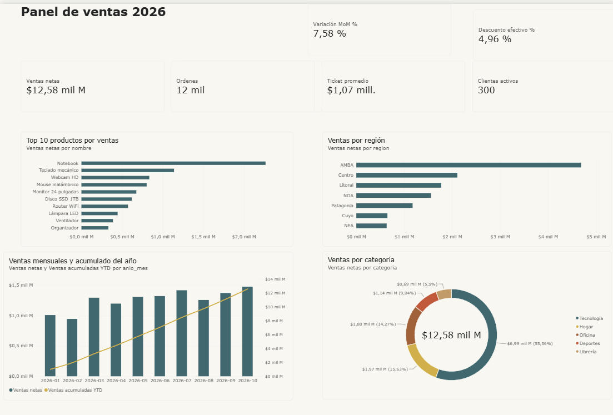

# Automatización de reportes — Pipeline ETL con Python y SQL

Proceso que **obtiene datos, los limpia y valida, los carga en un data warehouse y genera reportes
(Excel, HTML y un tablero de Power BI) de forma automática**, sin intervención manual y programable a diario.

`Python · SQL (SQLite) · ETL · pandas · openpyxl · matplotlib · Power BI · DAX · pytest · GitHub Actions`



## El problema

Un equipo comercial arma cada semana su reporte de ventas a mano: exporta CSV de varios sistemas, corrige errores
en Excel, copia tablas y gráficos. Es lento, propenso a errores y no deja rastro de qué datos se descartaron.
Este proyecto automatiza todo el ciclo y agrega **auditoría de calidad de datos**.

## Arquitectura

```
 data/raw/*.csv            Python (pandas)                 SQLite (esquema en estrella)         Salidas
┌──────────────┐   ┌─────────────────────────────┐   ┌──────────────────────────────┐   ┌───────────────────┐
│ ventas       │   │ EXTRACT   leer + validar    │   │ dim_cliente  dim_producto    │   │ reporte_ventas    │
│ clientes     ├──►│ TRANSFORM limpiar, validar, ├──►│ dim_fecha    fact_ventas     ├──►│  .xlsx (6 hojas + │
│ productos    │   │           calcular métricas │   │ etl_runs     etl_rechazos    │   │  gráfico nativo)  │
└──────────────┘   │ LOAD      upsert, 1 transac.│   └──────────────┬───────────────┘   │  .html (gráficos) │
                   └─────────────────────────────┘     consultas SQL versionadas        │  tablero Power BI  │
                                                       (sql/queries/*.sql, window funcs)└───────────────────┘
        Orquestación: CLI  ──►  Programador de tareas de Windows  /  GitHub Actions (cron)
```

## Qué demuestra

| Área | Implementación |
|---|---|
| **ETL** | Etapas separadas (`extract.py`, `transform.py`, `load.py`), orquestadas en `pipeline.py`. |
| **Calidad de datos** | 7 reglas de validación sobre ventas + deduplicación y normalización de clientes. Cada fila descartada se guarda con su motivo en `etl_rechazos`; el reporte incluye una sección de calidad. |
| **Modelado SQL** | Esquema en estrella con PK/FK, `CHECK` e índices (`sql/schema.sql`). |
| **SQL analítico** | CTEs y funciones de ventana: `LAG` (variación mensual), `RANK`, acumulados (Pareto 80/20), participación con `SUM() OVER ()`. |
| **Idempotencia** | `INSERT … ON CONFLICT DO UPDATE`: re-ejecutar no duplica datos (test incluido). |
| **Atomicidad** | La carga corre en una sola transacción; si algo falla hace rollback y la corrida queda marcada `ERROR`. |
| **Auditoría** | Tabla `etl_runs` con filas leídas / cargadas / rechazadas y estado por corrida. |
| **BI** | Modelo en estrella en Power BI con relaciones, tabla de fechas y medidas DAX (YTD, variación mensual, ticket promedio). |
| **Automatización** | Tarea programada de Windows (`scheduler/`) y workflow de GitHub Actions con cron. Código de salida ≠ 0 si falla. |
| **Calidad de software** | 12 tests (reglas, idempotencia, rollback, integridad referencial, cuadre de totales entre reportes y SQL), logging a archivo, configuración por entorno. |

## Cómo ejecutarlo

```powershell
python -m venv .venv
.\.venv\Scripts\pip install -e ".[dev]"

.\.venv\Scripts\python -m reportes ejecutar     # genera datos (si faltan) + ETL + reportes
.\.venv\Scripts\python -m pytest -q             # tests
```

Comandos sueltos: `generar-datos`, `etl`, `reportes`, `ejecutar --regenerar`. Resultados en `output/`, logs en `logs/pipeline.log`.

Automatizarlo todos los días a las 07:00 en Windows:

```powershell
powershell -ExecutionPolicy Bypass -File scheduler\registrar_tarea_windows.ps1 -Hora "07:00"
```

## Tablero de Power BI

El pipeline deja el modelo en estrella en `output/powerbi/` con **nombres de archivo fijos** (`modelo_ventas.xlsx` con las 4 tablas,
más un CSV por tabla), pensado para conectarlo a Power BI y refrescarlo con un solo clic después de cada corrida.

1. Ejecutar el pipeline (`reportes ejecutar`) para generar `output/powerbi/`.
2. Power BI Desktop → **Obtener datos → Excel** → `output/powerbi/modelo_ventas.xlsx` → cargar las 4 tablas.
3. Relaciones (muchos a uno): `fact_ventas[fecha]→dim_fecha[fecha]`, `fact_ventas[id_cliente]→dim_cliente[id_cliente]`,
   `fact_ventas[id_producto]→dim_producto[id_producto]`. Marcar `dim_fecha` como tabla de fechas.
4. Crear las medidas de [`docs/powerbi_medidas.dax`](docs/powerbi_medidas.dax).

El tablero de la captura incluye KPIs (ventas netas, órdenes, ticket promedio, clientes activos, variación contra el mes anterior,
descuento efectivo), evolución mensual con acumulado del año, top 10 de productos, ventas por región y por categoría.

Alternativas de conexión sin pasar por archivos:

- **Script de Python:** cada corrida genera `output/powerbi/conectar_sqlite.py` para *Obtener datos → Script de Python* (consulta SQLite en vivo).
- **ODBC:** instalar "SQLite3 ODBC Driver" y crear un DSN apuntando a `data/warehouse.db`. SQLite guarda las fechas como texto: cambiar `fecha` a tipo Fecha en Power Query.

## Resultados con el dataset de ejemplo

Datos **sintéticos** (semilla fija, reproducibles) con ~5 % de errores inyectados a propósito: duplicados, fechas
imposibles (`31/02`), cantidades negativas, clientes/productos inexistentes, descuentos > 100 %, textos inconsistentes.

- 12.466 filas leídas → 12.096 cargadas y **370 rechazadas con motivo** (ninguna se pierde en silencio).
- ETL completo en ~1 segundo; pipeline + reportes en pocos segundos.
- Segunda corrida: mismos totales (idempotente) y una nueva fila de auditoría.

## Estructura

```
src/reportes/   config · generate_data · extract · transform · load · reports · pipeline · cli
sql/            schema.sql · queries/*.sql (un reporte = una consulta versionada)
tests/          transformaciones, pipeline end-to-end, rollback, idempotencia
docs/           captura del tablero y medidas DAX de Power BI
scheduler/      registro de tarea diaria en Windows
.github/        CI: tests + pipeline + reportes como artefacto
```

## Decisiones de diseño

- **La lógica de negocio vive en SQL**, no en pandas: las consultas se pueden revisar y reutilizar desde cualquier herramienta de BI.
- **Todo se lee como texto** y la limpieza decide los tipos, para que un valor malo no rompa la lectura del archivo.
- **SQLite** por portabilidad (cero instalación). El código SQL usa sintaxis estándar; migrar a PostgreSQL implica cambiar la conexión y el `ON CONFLICT`.
- **Rechazar con motivo > corregir en silencio**: la única imputación (descuento vacío = 0, vendedor vacío = "Sin asignar") está documentada en el código.

## Próximos pasos posibles

Cargas incrementales por fecha, envío del reporte por mail, fuente adicional vía API REST, migración a PostgreSQL, alertas si la tasa de rechazos supera un umbral.

## Licencia

[MIT](LICENSE)
